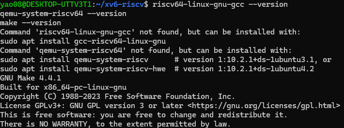
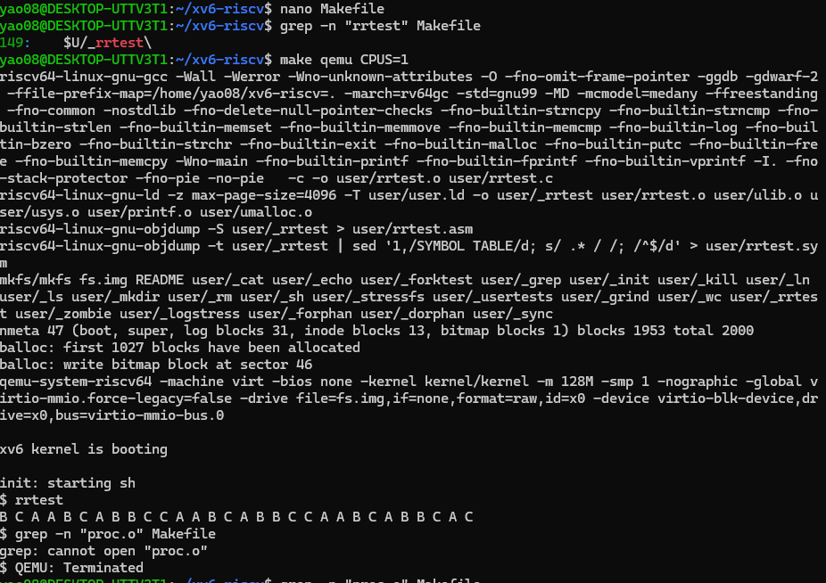
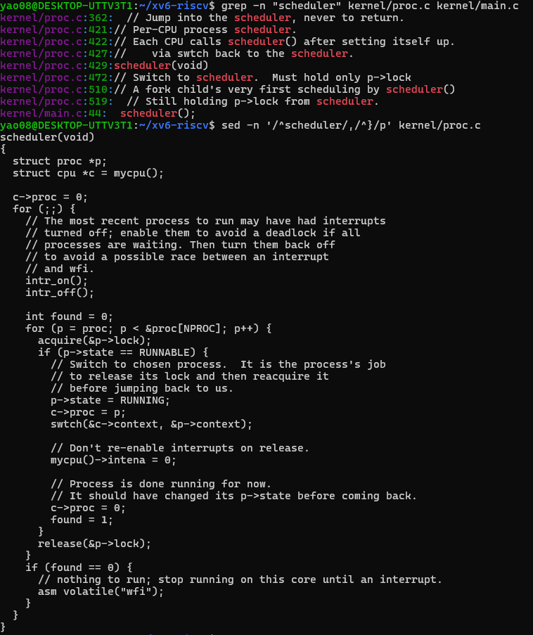

# Exploración de la planificación de procesos en XV6

**Integrantes:** LESDNY YAIR MORENO, LOHAR ESTIWAR RIVAS
**Repositorio:** https://github.com/6SOSA9/xv6-riscv

## 1. Repositorio y entorno

- **Sistema operativo:** Ubuntu 26.04.1 LTS (Resolute Raccoon) sobre WSL2, kernel `6.18.58.1-microsoft-standard-WSL2`.
- **Commit de partida:** `fa2ddcb7ca87a77af579380a6eafd5aff163b44f` (30 de octubre de 2026, "usertests: bound the zero-length pipe read regression test").
- **Herramientas y versiones:**
  - `riscv64-linux-gnu-gcc` 15.2.0 (Ubuntu 15.2.0-16ubuntu1)
  - QEMU 10.2.1 (Debian 1:10.2.1+ds-1ubuntu3.3)
  - GNU Make 4.4.1
- **Instalación:** `sudo apt install gcc-riscv64-linux-gnu binutils-riscv64-linux-gnu qemu-system-riscv gdb-multiarch build-essential git`. La primera vez falló con errores 404 por una lista de paquetes desactualizada; se resolvió con `sudo apt update` y reintentando con `--fix-missing`.




## 2. Compilación y ejecución

- **Comando de arranque:** `make qemu CPUS=1`
- **Una sola CPU virtual:** la línea de `qemu-system-riscv64` que imprime `make` incluye `-smp 1`. También se verificó sin ejecutar con `make -n qemu CPUS=1`, que muestra la misma opción.
- **XV6 operativo:** el sistema arranca (`xv6 kernel is booting`, `init: starting sh`), y los comandos `ls` y `cat README` funcionan y muestran la lista de archivos y el contenido del README.




## 3. Planificador original

### 3.1 Algoritmo: Round Robin

XV6 usa Round Robin. En `scheduler()` (`kernel/proc.c`) el planificador recorre la tabla `proc[]` con un `for` desde `proc[0]` hasta `proc[NPROC-1]` y, dentro del recorrido, solo comprueba `if (p->state == RUNNABLE)`. No compara prioridad, tiempo consumido ni ningún otro dato, así que todos los procesos listos son tratados igual y reciben su turno en orden circular. Al terminar la tabla, el `for (;;)` exterior reinicia el recorrido. El turno de cada proceso lo limita el temporizador (ver 3.3), que cumple el papel del quantum.

**Evidencia:** se creó `user/rrtest.c` (agregado a `UPROGS` en el `Makefile`). El programa crea 3 hijos; cada uno ejecuta un bucle de cálculo y luego imprime su letra (A, B o C), 10 veces. Con una sola CPU, la salida fue:

```
B C A A B C A B B C C A A B C A B B C C A A B C A B B C A C
```

Las letras salen intercaladas: ningún proceso termina antes de que los otros avancen, lo que indica que cada uno pierde la CPU y los tres se turnan. Cada letra aparece 10 veces, como se programó.

El orden no es un `A B C` perfecto (hay repeticiones como `A A` o `B B`, y la primera letra es B). Posibles causas: el tick del temporizador cae en un punto arbitrario del bucle de cálculo de cada hijo, por lo que un proceso puede completar su impresión justo antes o después de la interrupción; además, los hijos se crean uno tras otro con `fork()` y su avance depende del momento exacto de cada interrupción. Esto no contradice Round Robin: los tres procesos siguen turnándose, solo que la duración efectiva de cada turno varía respecto de las impresiones.


### 3.2 Dónde se elige el siguiente proceso

La selección ocurre en `scheduler()`, en `kernel/proc.c` (línea 429), llamada desde `main()` en `kernel/main.c` (línea 44). Fragmento:

```c
for (p = proc; p < &proc[NPROC]; p++) {
  acquire(&p->lock);
  if (p->state == RUNNABLE) {
    p->state = RUNNING;
    c->proc = p;
    swtch(&c->context, &p->context);
    c->proc = 0;
    found = 1;
  }
  release(&p->lock);
}
```

### 3.3 Relación con los estados y los eventos

**Cadena cuando el temporizador interrumpe:** llega la interrupción del temporizador y `devintr()` (`kernel/trap.c`) llama a `clockintr()` y devuelve 2. Con `which_dev == 2`, `usertrap()` (o `kerneltrap()`) llama a `yield()`, que pone el proceso en `RUNNABLE` y llama a `sched()`. `sched()` hace `swtch` hacia el contexto del planificador, que estaba detenido dentro del `swtch` de `scheduler()`. Ese `swtch` retorna, `scheduler()` pone `c->proc = 0`, suelta el candado del proceso y el `for` avanza con `p++` hasta el siguiente `RUNNABLE`, al que marca `RUNNING` y le cede la CPU con otro `swtch`.

Código que lo respalda:

- `kernel/trap.c`, `devintr()`: si `scause == 0x8000000000000005L`, ejecuta `clockintr()` y `return 2`. Los dispositivos externos devuelven 1.
- `kernel/trap.c`, `usertrap()`, línea 86: `if (which_dev == 2) yield();`
- `kernel/trap.c`, `kerneltrap()`, línea 158: `if (which_dev == 2 && myproc() != 0) yield();` (la condición extra evita ceder si la interrupción llegó cuando no había proceso corriendo).
- `kernel/proc.c`, `yield()`: toma `p->lock`, asigna `p->state = RUNNABLE`, llama a `sched()` y luego suelta el candado.
- `kernel/proc.c`, `sched()`: verifica condiciones (entra en pánico si `p->state == RUNNING`, lo que obliga al llamador a cambiar antes el estado) y ejecuta `swtch(&p->context, &mycpu()->context)`.

**Otras transiciones de estado:**

- `RUNNABLE → RUNNING`: la hace `scheduler()` al elegir un proceso.
- `RUNNING → RUNNABLE`: la hace `yield()` cuando el temporizador interrumpe.
- `RUNNING → SLEEPING`: en esta versión, dormir se hace en dos pasos. Primero `sleep_prepare(chan)` registra al proceso en un canal (`p->chan = chan`, línea 554, y entra en pánico si `chan == 0`). Después `sleep()` (línea 567) comprueba `if (p->chan != 0)`; si es así, pone `p->state = SLEEPING` y llama a `sched()`.
- `SLEEPING → RUNNABLE`: `wakeup(chan)` recorre `proc[]`; a los procesos con `p->chan == chan` les pone `p->chan = 0` (línea 585) y, si ya estaban `SLEEPING`, los pasa a `RUNNABLE`. `wakeup()` no entrega la CPU: solo vuelve elegible al proceso, y es `scheduler()` quien lo pone a correr cuando le toca en su recorrido.

**Observaciones sobre esta versión del código:**

- `sleep(void)` no recibe argumentos, a diferencia de `sleep(chan, lk)` del libro de XV6. Las respuestas se basan en el código del commit de partida.
- El comentario de `wakeup()` dice que deja al proceso en "RUNNING", pero el código asigna `RUNNABLE`; se tomó el código como referencia.
- Por el diseño en dos pasos, si un `wakeup()` ocurre entre `sleep_prepare()` y `sleep()`, `p->chan` ya vale 0 y `sleep()` no duerme, lo que evitaría perder el despertar. Esta es una interpretación a partir del código, no verificada con pruebas.

### 3.4 Incorporación al sistema compilado

- `Makefile`, línea 15: `$K/proc.o` aparece en la lista `OBJS` del kernel; `proc.c` se compila a `proc.o` con la regla general de `.c` a `.o`.
- `Makefile`, líneas 94-95: la regla `$K/kernel: $(OBJS) $K/kernel.ld` enlaza todos los objetos con `$(LD) $(LDFLAGS) -T $K/kernel.ld -o $K/kernel $(OBJS)`.
- `Makefile`, línea 179: `QEMUOPTS` carga ese binario con `-kernel $K/kernel`.
- `kernel/main.c`, línea 44: al terminar la inicialización, `main()` llama a `scheduler()`, que no retorna.

Cadena: `kernel/proc.c` → `proc.o` → lista `OBJS` → enlazado en `kernel/kernel` → qemu lo carga → `main()` llama a `scheduler()`.

## 4. Exploración de MLFQ

[Sección del compañero: descripción inicial (prompt 1), descripción revisada, propuesta de cambios con archivos y funciones, decisiones por investigar, conclusiones y retroalimentación de la IA.]

## 5. Escenarios de comprobación futura

[Sección del compañero: para cada escenario, procesos que participan, qué hacen, regla que se comprueba y comportamiento esperado.]

## 6. Evidencia del aprendizaje con IA

**Servicio y modelo de IA utilizado:** CLAUDE SONNET 5.5 

[De 3 a 5 intercambios significativos del diálogo, con una hipótesis, una comprobación y una corrección.]

### Reflexión individual

**YAIR MORENO:** En esta entrega preparé el entorno (WSL2 con Ubuntu 26.04, gcc 15.2.0, QEMU 10.2.1 y Make 4.4.1), arranqué XV6 con una sola CPU y leí el código del planificador. Comprendí que `scheduler()` recorre `proc[]` y elige procesos `RUNNABLE` sin prioridades, que el quantum no vive en `scheduler()` sino en la interrupción del temporizador (`yield()` desde `usertrap()`), y que `sleep()`/`wakeup()` mueven procesos entre `SLEEPING` y `RUNNABLE`. Aporté las capturas de entorno y ejecución, la lectura del código con `grep` y `sed`, y el programa `rrtest` para mostrar el comportamiento. Me falta estudiar mejor cómo funciona `swtch` a nivel de registros y por qué `sleep_prepare()`/`sleep()` se separan en dos pasos, que verifiqué solo leyendo el código.

**LOHAR RIVAS:** [COMPLETAR por el compañero.]
