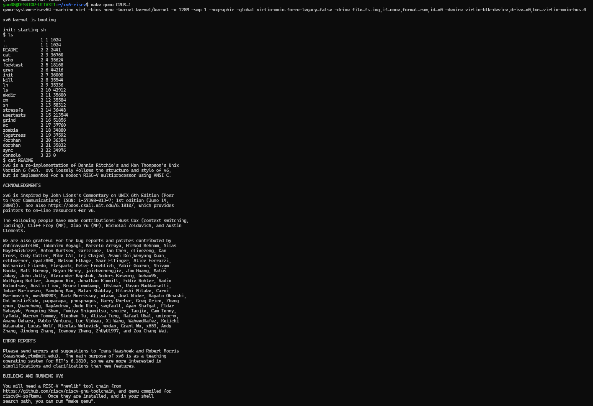

# Exploración de la planificación de procesos en XV6

**Integrantes:** LESDNY YAIR MORENO, LOHAR ESTIWAR RIVAS
**Repositorio:** https://github.com/6SOSA9/xv6-riscv

## 1. Repositorio y entorno

- **Sistema operativo:** Ubuntu 26.04.1 LTS (Resolute Raccoon) sobre WSL2, kernel `6.18.58.1-microsoft-standard-WSL2`.
- **Commit de partida:** `fa2ddcb7ca87a77af579380a6eafd5aff163b44f` (30 de octubre de 2026, "usertests: bound the zero-length pipe read regression test").
- **Herramientas y versiones:**
  - `riscv64-linux-gnu-gcc` 15.2.0 (Ubuntu 15.2.0-16ubuntu1)
  - QEMU 10.2.1 (Debian 1:10.2.1+ds-1ubuntu3.3)
  - GNU Make 4.4.1
- **Instalación:** `sudo apt install gcc-riscv64-linux-gnu binutils-riscv64-linux-gnu qemu-system-riscv gdb-multiarch build-essential git`. La primera vez falló con errores 404 por una lista de paquetes desactualizada; se resolvió con `sudo apt update` y reintentando con `--fix-missing`.




## 2. Compilación y ejecución

- **Comando de arranque:** `make qemu CPUS=1`
- **Una sola CPU virtual:** la línea de `qemu-system-riscv64` que imprime `make` incluye `-smp 1`. También se verificó sin ejecutar con `make -n qemu CPUS=1`, que muestra la misma opción.
- **XV6 operativo:** el sistema arranca (`xv6 kernel is booting`, `init: starting sh`), y los comandos `ls` y `cat README` funcionan y muestran la lista de archivos y el contenido del README.


## 3. Planificador original

### 3.1 Algoritmo: Round Robin

XV6 usa Round Robin. En `scheduler()` (`kernel/proc.c`) el planificador recorre la tabla `proc[]` con un `for` desde `proc[0]` hasta `proc[NPROC-1]` y, dentro del recorrido, solo comprueba `if (p->state == RUNNABLE)`. No compara prioridad, tiempo consumido ni ningún otro dato, así que todos los procesos listos son tratados igual y reciben su turno en orden circular. Al terminar la tabla, el `for (;;)` exterior reinicia el recorrido. El turno de cada proceso lo limita el temporizador (ver 3.3), que cumple el papel del quantum.

**Evidencia:** se creó `user/rrtest.c` (agregado a `UPROGS` en el `Makefile`). El programa crea 3 hijos; cada uno ejecuta un bucle de cálculo y luego imprime su letra (A, B o C), 10 veces. Con una sola CPU, la salida fue:

```
B C A A B C A B B C C A A B C A B B C C A A B C A B B C A C
```

Las letras salen intercaladas: ningún proceso termina antes de que los otros avancen, lo que indica que cada uno pierde la CPU y los tres se turnan. Cada letra aparece 10 veces, como se programó.

El orden no es un `A B C` perfecto (hay repeticiones como `A A` o `B B`, y la primera letra es B). Posibles causas: el tick del temporizador cae en un punto arbitrario del bucle de cálculo de cada hijo, por lo que un proceso puede completar su impresión justo antes o después de la interrupción; además, los hijos se crean uno tras otro con `fork()` y su avance depende del momento exacto de cada interrupción. Esto no contradice Round Robin: los tres procesos siguen turnándose, solo que la duración efectiva de cada turno varía respecto de las impresiones.


### 3.2 Dónde se elige el siguiente proceso

La selección ocurre en `scheduler()`, en `kernel/proc.c` (línea 429), llamada desde `main()` en `kernel/main.c` (línea 44). Fragmento:

```c
for (p = proc; p < &proc[NPROC]; p++) {
  acquire(&p->lock);
  if (p->state == RUNNABLE) {
    p->state = RUNNING;
    c->proc = p;
    swtch(&c->context, &p->context);
    c->proc = 0;
    found = 1;
  }
  release(&p->lock);
}
```

### 3.3 Relación con los estados y los eventos

**Cadena cuando el temporizador interrumpe:** llega la interrupción del temporizador y `devintr()` (`kernel/trap.c`) llama a `clockintr()` y devuelve 2. Con `which_dev == 2`, `usertrap()` (o `kerneltrap()`) llama a `yield()`, que pone el proceso en `RUNNABLE` y llama a `sched()`. `sched()` hace `swtch` hacia el contexto del planificador, que estaba detenido dentro del `swtch` de `scheduler()`. Ese `swtch` retorna, `scheduler()` pone `c->proc = 0`, suelta el candado del proceso y el `for` avanza con `p++` hasta el siguiente `RUNNABLE`, al que marca `RUNNING` y le cede la CPU con otro `swtch`.

Código que lo respalda:

- `kernel/trap.c`, `devintr()`: si `scause == 0x8000000000000005L`, ejecuta `clockintr()` y `return 2`. Los dispositivos externos devuelven 1.
- `kernel/trap.c`, `usertrap()`, línea 86: `if (which_dev == 2) yield();`
- `kernel/trap.c`, `kerneltrap()`, línea 158: `if (which_dev == 2 && myproc() != 0) yield();` (la condición extra evita ceder si la interrupción llegó cuando no había proceso corriendo).
- `kernel/proc.c`, `yield()`: toma `p->lock`, asigna `p->state = RUNNABLE`, llama a `sched()` y luego suelta el candado.
- `kernel/proc.c`, `sched()`: verifica condiciones (entra en pánico si `p->state == RUNNING`, lo que obliga al llamador a cambiar antes el estado) y ejecuta `swtch(&p->context, &mycpu()->context)`.

**Otras transiciones de estado:**

- `RUNNABLE → RUNNING`: la hace `scheduler()` al elegir un proceso.
- `RUNNING → RUNNABLE`: la hace `yield()` cuando el temporizador interrumpe.
- `RUNNING → SLEEPING`: en esta versión, dormir se hace en dos pasos. Primero `sleep_prepare(chan)` registra al proceso en un canal (`p->chan = chan`, línea 554, y entra en pánico si `chan == 0`). Después `sleep()` (línea 567) comprueba `if (p->chan != 0)`; si es así, pone `p->state = SLEEPING` y llama a `sched()`.
- `SLEEPING → RUNNABLE`: `wakeup(chan)` recorre `proc[]`; a los procesos con `p->chan == chan` les pone `p->chan = 0` (línea 585) y, si ya estaban `SLEEPING`, los pasa a `RUNNABLE`. `wakeup()` no entrega la CPU: solo vuelve elegible al proceso, y es `scheduler()` quien lo pone a correr cuando le toca en su recorrido.

**Observaciones sobre esta versión del código:**

- `sleep(void)` no recibe argumentos, a diferencia de `sleep(chan, lk)` del libro de XV6. Las respuestas se basan en el código del commit de partida.
- El comentario de `wakeup()` dice que deja al proceso en "RUNNING", pero el código asigna `RUNNABLE`; se tomó el código como referencia.
- Por el diseño en dos pasos, si un `wakeup()` ocurre entre `sleep_prepare()` y `sleep()`, `p->chan` ya vale 0 y `sleep()` no duerme, lo que evitaría perder el despertar. Esta es una interpretación a partir del código, no verificada con pruebas.

### 3.4 Incorporación al sistema compilado

- `Makefile`, línea 15: `$K/proc.o` aparece en la lista `OBJS` del kernel; `proc.c` se compila a `proc.o` con la regla general de `.c` a `.o`.
- `Makefile`, líneas 94-95: la regla `$K/kernel: $(OBJS) $K/kernel.ld` enlaza todos los objetos con `$(LD) $(LDFLAGS) -T $K/kernel.ld -o $K/kernel $(OBJS)`.
- `Makefile`, línea 179: `QEMUOPTS` carga ese binario con `-kernel $K/kernel`.
- `kernel/main.c`, línea 44: al terminar la inicialización, `main()` llama a `scheduler()`, que no retorna.

Cadena: `kernel/proc.c` → `proc.o` → lista `OBJS` → enlazado en `kernel/kernel` → qemu lo carga → `main()` llama a `scheduler()`.

## 4. Exploración de MLFQ

### 4.1 Descripción inicial de MLFQ y Prompt 1

**Descripción inicial (escrita antes de consultar a la IA):**

El algoritmo MLFQ sirve para organizar los procesos en varias colas con distinta prioridad y así atender rápido los programas cortos sin saber cuánto duran. Lo que entendemos hasta ahora es:

1. **Prioridad entre colas:** Siempre corre el proceso que está en la cola de mayor prioridad para que los procesos urgentes no esperen a los pesados. Si hay varios en la misma cola, se turnan.
2. **Entrada al sistema:** Todo proceso nuevo entra directo a la cola más alta porque el sistema no sabe si es largo o corto y asume que va a terminar rápido.
3. **Degradación por uso de CPU:** Cada cola tiene un tiempo límite. Si un proceso gasta todo ese tiempo usando la CPU, baja a una cola de menor prioridad. Esto sirve para ir mandando abajo a los procesos pesados.
4. **Reinicio periódico:** Cada cierto tiempo todos los procesos vuelven a subir a la cola más alta para que los procesos pesados de abajo no se queden sin correr nunca.

*Ejemplo:* Si entra un Proceso A que hace cálculos largos, empieza en la cola alta, pero como gasta su tiempo límite va bajando hasta la cola baja. Si después llega un Proceso B que es corto, entra a la cola alta y corre primero porque tiene más prioridad. Cuando acaba, sigue el Proceso A.

*Dudas identificadas antes de la IA:*
- No sabemos qué pasa si un proceso suelta la CPU antes de acabar su tiempo límite (por ejemplo, pidiendo algo por teclado): si se queda en la misma cola con el tiempo reiniciado o si se le sigue sumando lo que ya gastó.
- No nos queda claro cada cuánto tiempo se hace el reinicio periódico de la regla 4 ni cuántas colas habría que poner en XV6.

**Prompt 1 utilizado:**

> Actúa como tutor socrático de una pareja de estudiantes de cuarto semestre de Ingeniería de Sistemas. Conocemos C++ y hemos comenzado a explorar XV6 para RISC-V. Queremos identificar y justificar qué se necesitaría para incorporar MLFQ a XV6. En esta entrega no vamos a implementarlo.
>
> Nuestra descripción inicial del algoritmo, escrita antes de esta conversación: [Descripción inicial y dudas incluidas arriba].
>
> Lo que averiguamos del planificador original y de su incorporación al sistema compilado: XV6 usa Round Robin en `scheduler()` (`kernel/proc.c`, línea 429), llamada desde `main()` (`kernel/main.c`, línea 44), recorriendo `proc[NPROC]` en busca de procesos `RUNNABLE` sin prioridades. El cambio de turno ocurre mediante interrupción de temporizador: `devintr()` (`kernel/trap.c`) llama a `clockintr()` y retorna 2; luego `usertrap()` (línea 86) o `kerneltrap()` (línea 158) llaman a `yield()`, que cambia el estado a `RUNNABLE` y llama a `sched()` para hacer `swtch`. Para E/S se usan `sleep_prepare(chan)`, `sleep()` (`SLEEPING`) y `wakeup(chan)` (`RUNNABLE`). Todo se compila vía `$K/proc.o` en `OBJS` dentro del `Makefile` hacia `$K/kernel`.

### 4.2 Descripción revisada de MLFQ

Tras la discusión socrática y el contraste con el libro OSTEP, consolidamos la variante de MLFQ adecuada para XV6 con 5 reglas precisas:

1. **Prioridad estricta entre colas:** Si $\text{Prioridad}(A) > \text{Prioridad}(B)$, se ejecuta $A$ (asumiendo niveles numéricos donde `0` es la prioridad máxima y `NQUEUES - 1` la mínima).
2. **Round-Robin dentro de la misma cola:** Si dos o más procesos están en el mismo nivel de prioridad, se turnan de manera circular usando el quantum asignado a esa cola (siendo más corto en colas altas para dar respuesta rápida y más largo en colas bajas para reducir cambios de contexto).
3. **Ingreso por nivel superior:** Todo proceso recién creado entra en la cola de máxima prioridad (`0`), asumiendo inicialmente que será corto o interactivo.
4. **Degradación con contabilidad acumulada (anti-trampas):** Cada nivel tiene un presupuesto de tiempo (*allotment*). El sistema acumula los ticks de CPU que el proceso consume en su nivel actual sin reiniciarlos cuando cede la CPU por entrada/salida (`sleep()`). Solo cuando la suma acumulada alcanza el *allotment* del nivel, el proceso baja una cola y su contador acumulado vuelve a `0`. Así se evita que un proceso haga trampa soltando la CPU justo antes de acabar su turno.
5. **Reinicio periódico (*Priority Boost*):** Cada cierto período global de $S$ ticks, todos los procesos del sistema suben de nuevo a la cola más alta (`0`) y reinician sus contadores. Esto evita la inanición (*starvation*) de los procesos pesados y permite que un proceso que cambie de comportamiento vuelva a ser atendido rápido.

### 4.3 Propuesta de cambios en XV6

Para incorporar MLFQ sin usar memoria dinámica (`malloc`) y respetando la estructura estática `proc[NPROC]` y los candados (`p->lock`) de XV6, se proponen las siguientes modificaciones:

| Archivo / función | Necesidad que atiende | Por qué |
| :--- | :--- | :--- |
| `kernel/param.h` | Definir constantes globales del planificador (`NQUEUES`, arreglo de quantums por cola, límites de `allotment` por nivel y `BOOST_TICKS = S`). | Centraliza los parámetros de afinación para equilibrar baja latencia en tareas interactivas (quantums cortos arriba) y menor sobrecarga de cambio de contexto en tareas pesadas (quantums largos abajo). |
| `kernel/proc.h` (`struct proc`) | Agregar los campos `int priority`, `int quantum_ticks` y `int allotment_ticks`. | Permite simular las múltiples colas sobre el arreglo estático `proc[NPROC]` sin listas dinámicas, y evita el *gaming the scheduler* al mantener persistente `allotment_ticks` entre bloqueos de E/S. |
| `kernel/proc.c` (`allocproc`) | Inicializar `p->priority = 0`, `p->quantum_ticks = 0` y `p->allotment_ticks = 0`. | Garantiza el cumplimiento de la Regla 3: todo proceso nuevo inicia en la cola de mayor prioridad. |
| `kernel/trap.c` (`usertrap` y `kerneltrap`) | En cada interrupción de reloj (`which_dev == 2`), incrementar `quantum_ticks` y `allotment_ticks` de `myproc()`. Degradar `priority` si se agota `allotment_ticks`, y llamar a `yield()` solo si agota su `quantum_ticks` o si hay un proceso `RUNNABLE` de mayor prioridad. | Actualmente XV6 llama a `yield()` en cada tick; este cambio permite respetar quantums distintos por cola, ejecutar la degradación (Regla 4) y permitir preempción cuando despierta un proceso prioritario. |
| `kernel/proc.c` (`scheduler`) | 1) Verificar si transcurrieron $S$ ticks globales para ejecutar el *Priority Boost*. 2) Iterar por niveles (`0` a `NQUEUES - 1`) recorriendo `proc[NPROC]` circularmente mediante un arreglo de índices `last_idx[nivel]`. | Garantiza el orden estricto entre colas (Regla 1), un Round-Robin real dentro de cada nivel sin favorecer siempre los índices bajos de `proc[]` (Regla 2), y evita *deadlocks* al tomar `p->lock` fuera de una interrupción de reloj (Regla 5). |
| `kernel/proc.c` (`sleep_prepare` / `sleep` / `wakeup`) | Conservar `priority` y `allotment_ticks` intactos al dormir; en `wakeup()`, reiniciar solo `quantum_ticks = 0` al pasar el proceso a `RUNNABLE`. | Protege a los procesos interactivos para que no pierdan prioridad al esperar E/S, pero mantiene su historial acumulado del nivel para impedir trampas. |
| `Makefile` | No requiere agregar nuevos archivos objeto a `OBJS`. | Como toda la lógica reside en `kernel/proc.c` y `kernel/trap.c` (ya compilados como `$K/proc.o` y `$K/trap.o` hacia `$K/kernel`), el flujo de construcción existente se mantiene intacto. |

### 4.4 Decisiones pendientes de investigar o corroborar

1. **Calibración experimental de constantes ($S$, `NQUEUES`, quantums y *allotments*):** Los valores óptimos (por ejemplo, 3 o 4 colas con quantums de 1, 2, 4 y 8 ticks, y un boost cada 100 o 200 ticks) dependen de la carga real de procesos en XV6 y deben ajustarse mediante pruebas empíricas para evitar que $S$ sea tan corto que degenere en Round-Robin o tan largo que cause inanición.
2. **Preempción inmediata en entornos multi-CPU (`CPUS > 1`):** En una sola CPU (`CPUS=1`), evaluar en el siguiente tick de `trap.c` si despertó un proceso de mayor prioridad es suficiente. Sin embargo, si XV6 corre con múltiples núcleos, quedaría pendiente investigar cómo enviar una interrupción entre procesadores (IPI) desde `wakeup()` para desalojar de inmediato a un núcleo que esté corriendo un proceso de baja prioridad sin esperar al siguiente tick.
3. **Orden de inserción tras despertar de E/S:** Confirmar si un proceso que vuelve de `SLEEPING` debe esperar su turno según el puntero circular `last_idx[nivel]` o si conviene darle alguna ventaja dentro de su misma cola.

### 4.5 Conclusiones y retroalimentación de la IA

- **Conclusiones:** Incorporar MLFQ en XV6 no exige reescribir todo el kernel ni introducir estructuras dinámicas complejas, ya que el arreglo estático `proc[NPROC]` permite representar las colas mediante atributos en `struct proc`. El aprendizaje clave fue comprender que el corazón del cambio reside en desacoplar el tick del temporizador (`trap.c`) del cambio de contexto inmediato (`yield()`), acumulando los ticks para evitar trampas de E/S y trasladando el reinicio periódico (`Priority Boost`) a `scheduler()` para evitar interbloqueos (*deadlocks*) con `p->lock`.
- **Retroalimentación de la IA:** El diálogo socrático permitió corregir dos fallos importantes de nuestro planteamiento inicial: primero, nos hizo notar que reiniciar el tiempo consumido al hacer E/S permitía monopolizar la CPU (*gaming the scheduler*), llevándonos a separar `quantum_ticks` de `allotment_ticks`; segundo, nos ayudó a detectar que recorrer `proc[]` siempre desde el índice `0` rompería el Round-Robin dentro de una misma cola y que hacer el *Priority Boost* dentro de `clockintr()` provocaría un *panic* por doble adquisición de `p->lock`.

---

## 5. Escenarios de comprobación futura

*Nota: Para plantear estos escenarios asumimos provisionalmente un esquema de 3 colas (Cola 0 Alta, Cola 1 Media y Cola 2 Baja).*

### Escenario 1: Proceso corto contra proceso largo
- **Procesos que participan:** Un proceso largo **A** (cálculo intensivo) y un proceso corto **B** (un comando rápido).
- **Qué hace cada proceso:** **A** empieza primero y, tras consumir su presupuesto en las colas superiores, queda corriendo en la Cola 2 (baja). Mientras **A** corre allí, se lanza **B**.
- **Regla que se quiere comprobar:** Regla 1 (corre el de mayor prioridad) y Regla 3 (todo proceso nuevo entra en la cola más alta).
- **Comportamiento esperado:** Como **B** es nuevo, entra en la Cola 0 y desaloja a **A**. **B** termina rápido y recién cuando **B** finaliza, **A** vuelve a recibir la CPU.

### Escenario 2: Un proceso pesado que baja de cola
- **Procesos que participan:** Un único proceso **A** que ejecuta ciclos matemáticos largos sin hacer pausas de E/S.
- **Qué hace cada proceso:** **A** entra al sistema y usa toda la CPU disponible de forma continua.
- **Regla que se quiere comprobar:** Regla 4 (degradación al agotar el *allotment* de cada nivel).
- **Comportamiento esperado:** **A** arranca en la Cola 0; al gastar su *allotment* baja a la Cola 1, y al volver a agotarlo baja a la Cola 2, donde permanece ejecutándose con turnos más largos.

### Escenario 3: Reinicio periódico para evitar inanición
- **Procesos que participan:** Un proceso pesado **A** y varios procesos cortos **B1, B2, B3** que llegan continuamente.
- **Qué hace cada proceso:** **A** ya cayó hasta la Cola 2 y siguen llegando procesos **B** a la Cola 0 sin parar. En ese momento se cumple el tiempo global $S$ del reinicio.
- **Regla que se quiere comprobar:** Regla 5 (*Priority Boost* periódico).
- **Comportamiento esperado:** Antes del reinicio, **A** queda detenido porque los procesos **B** ocupan la cola superior. Al cumplirse los $S$ ticks, **A** sube de nuevo a la Cola 0 y logra turnarse en Round-Robin con los demás para avanzar en su ejecución.

### Escenario 4: Proceso interactivo con pausas de E/S y contabilidad acumulada
- **Procesos que participan:** Un proceso interactivo **C** (que pide datos por consola) y un proceso largo **A** (en Cola 2).
- **Qué hace cada proceso:** **C** entra a la Cola 0, usa la CPU por menos tiempo que su quantum y llama a `sleep()` esperando entrada por teclado. Luego recibe el dato y vuelve a `RUNNABLE`.
- **Regla que se quiere comprobar:** Regla 4 refinada (contabilidad acumulada en un mismo nivel sin penalizar E/S).
- **Comportamiento esperado:** Al soltar la CPU antes de agotar su límite, **C** conserva su prioridad en la Cola 0 y responde de inmediato por encima de **A** cuando llega el dato. Sin embargo, si **C** repite este ciclo muchas veces hasta que la suma acumulada (`allotment_ticks`) alcance el límite de la Cola 0, finalmente bajará a la Cola 1 (evitando trampas).

---

## 6. Evidencia del aprendizaje con IA

**Servicio y modelo de IA utilizado:** Google Gemini (y Claude Sonnet para organización inicial).

### 6.1 Intercambios seleccionados del diálogo socrático

#### Intercambio 1 (Hipótesis sobre E/S y contadores en `struct proc`)
**IA:** ¿Qué pasaría si un programador malicioso escribe un ciclo infinito que hace `sleep(1)` justo antes de que se acabe su quantum? Si el contador de tiempo usado se reiniciara cada vez que cede la CPU, ¿podría monopolizar la cola más alta? ¿Cómo deberían contabilizar el tiempo en `struct proc`?  
**Nosotros:** Si reiniciáramos el contador cuando el proceso hace `sleep()`, podría soltar la CPU justo antes de acabar su tiempo y quedarse siempre en la cola alta. Para evitarlo, en `struct proc` hay que llevar un contador acumulado de los ticks gastados en ese nivel (`allotment_ticks`). Si hace E/S no baja de cola, pero conserva lo que ya gastó; ese contador solo vuelve a 0 cuando baja de nivel o cuando hay reinicio periódico.

#### Intercambio 2 (Comprobación del desempate Round-Robin en el arreglo `proc[NPROC]`)
**IA:** Imaginen que P0 y P1 están ambos en la cola 0 con quantum de 1 tick y allotment de 2 ticks. P0 corre 1 tick, llama a `yield()` y vuelve a `RUNNABLE`. Si `scheduler()` vuelve a empezar su ciclo `for` desde `i = 0`, ¿a quién va a volver a elegir primero? ¿Qué necesitan cambiar para garantizar que P0 y P1 se turnen?  
**Nosotros:** Si `scheduler()` siempre arranca en `i = 0`, va a agarrar siempre a P0 y P1 se queda esperando hasta que P0 baje. Para que de verdad hagan Round-Robin, habría que guardar en qué índice quedó cada cola (por ejemplo un arreglo `last_idx` por nivel) para que la próxima vez siga buscando desde el siguiente proceso en `proc[]` y no desde cero.

#### Intercambio 3 (Corrección sobre concurrencia y candados en el *Priority Boost*)
**IA:** Si ejecutan el *Priority Boost* dentro de `clockintr()` (en `trap.c`), tendrán que recorrer los `NPROC` procesos y adquirir cada `p->lock` dentro de una rutina de interrupción. ¿Qué riesgos de *deadlock* ven entre hacerlo en `clockintr()` vs. hacerlo en `scheduler()`?  
**Nosotros:** Hacerlo dentro de `clockintr()` es mala idea porque si la interrupción cae justo cuando un proceso ya tiene su `p->lock` agarrado (como en `yield()` o `sched()`), al intentar agarrarlo otra vez se traba todo en un *deadlock* (`panic`). Es mejor hacerlo en `scheduler()` revisando si los `ticks` globales ya llegaron a $S$, ahí sí se puede recorrer `proc[]` tomando y soltando cada `p->lock` tranquilo.

### 6.2 Reflexión individual

**LESDNY YAIR MORENO:** En esta entrega preparé el entorno (WSL2 con Ubuntu 26.04, gcc 15.2.0, QEMU 10.2.1 y Make 4.4.1), arranqué XV6 con una sola CPU y leí el código del planificador. Comprendí que `scheduler()` recorre `proc[]` y elige procesos `RUNNABLE` sin prioridades, que el quantum no vive en `scheduler()` sino en la interrupción del temporizador (`yield()` desde `usertrap()`), y que `sleep()`/`wakeup()` mueven procesos entre `SLEEPING` y `RUNNABLE`. Aporté las capturas de entorno y ejecución, la lectura del código con `grep` y `sed`, y el programa `rrtest` para mostrar el comportamiento. Me falta estudiar mejor cómo funciona `swtch` a nivel de registros y por qué `sleep_prepare()`/`sleep()` se separan en dos pasos, que verifiqué solo leyendo el código.

**LOHAR ESTIWAR RIVAS:** En esta entrega trabajé en el diseño conceptual y arquitectónico para incorporar el algoritmo MLFQ en XV6. Comprendí cómo el sistema operativo puede clasificar procesos dinámicamente sin conocer su duración previa, acumulando los ticks consumidos (`allotment_ticks`) para evitar que los procesos hagan trampa cediendo la CPU mediante operaciones de E/S, y cómo desacoplar la interrupción de reloj en `trap.c` para permitir quantums variables por nivel. Aporté la descripción inicial y revisada de MLFQ, la conducción del diálogo socrático para definir los cambios en `struct proc`, `trap.c` y `scheduler()`, y el diseño de los cuatro escenarios de comprobación futura. Aún necesito estudiar con mayor profundidad cómo sincronizar la preempción entre múltiples núcleos mediante interrupciones entre procesadores (IPI) cuando XV6 se ejecuta con más de una CPU virtual.